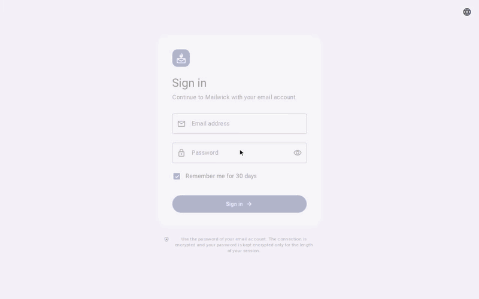
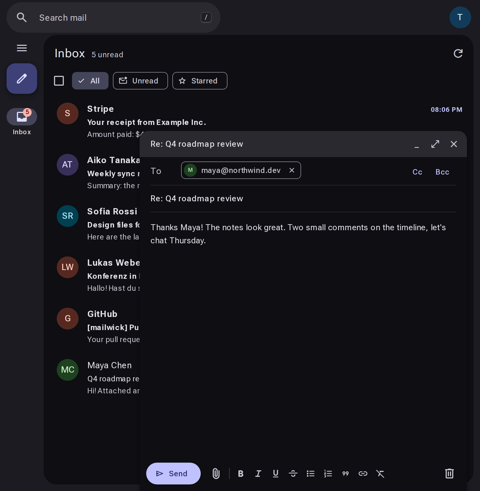
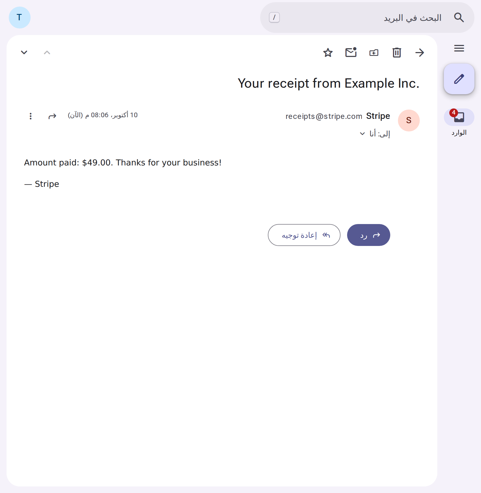

<p align="center">
  
</p>

<h1 align="center">Mailwick</h1>

<p align="center">
  A modern, self-hosted webmail client for any IMAP/SMTP server.<br>
  Material 3 design · 30 languages · one container.
</p>

<p align="center">
  
  <br>
  <sub><a href="docs/demo.mp4">Full-quality video (MP4)</a></sub>
</p>

Mailwick is a webmail front end. It doesn't run a mail server or keep a copy of your mail. It connects to the mail server you already have, such as Stalwart, Dovecot, Postfix+Dovecot, mailcow or a hosted provider, over IMAP and SMTP. People sign in with their existing email address and password.

## Features

- **Fast, familiar mail UI.** Conversation view, keyboard shortcuts (Gmail-style `j`/`k`/`e`/`r`/`#`…), drag and drop into folders, bulk actions, and selecting an entire folder.
- **Search that works.** Operators such as `from:`, `to:`, `subject:`, `has:attachment`, `is:unread`, `before:` and `after:`, plus searching across all folders.
- **Composer.** Rich text, a signature, attachments up to 25 MB (paste screenshots straight in), recipient suggestions, automatic drafts and **undo send**.
- **Live updates.** IMAP IDLE pushes new mail to the open tab, with optional desktop notifications.
- **Privacy by default.** Remote images are blocked until you allow them (per message or per sender). Mail HTML is sanitized and rendered in a sandboxed iframe without scripts.
- **Material 3 dynamic color.** Light/dark/system theme, any accent color, contrast levels and a compact density.
- **30 languages, RTL included.** The UI follows the browser language and can be switched in Settings or on the sign-in page. Arabic, Hebrew and Persian get a right-to-left layout.
- **Responsive.** Three panes on desktop, a navigation rail on tablets and a single pane on phones.
- **Folder management.** Create, nest, rename and delete folders, empty Trash and Junk, and mark a folder as read.
- **Small footprint.** One Node.js process plus Redis. No database.

<p align="center">
  
  
</p>

## Quick start (Docker)

```bash
git clone https://github.com/Anysola/mailwick.git
cd mailwick
cp .env.example .env
# set SESSION_SECRET (openssl rand -base64 48) and IMAP_HOST
docker compose up -d
```

Mailwick now listens on `http://127.0.0.1:3000`. Put it behind HTTPS (see [Reverse proxy](#reverse-proxy)) before you use it over a network, because the session cookie is only sent over HTTPS in production.

### Without Docker

You need Node.js 20.9 or newer and Redis 6 or newer.

```bash
npm ci
cp .env.example .env.local   # fill it in
npm run build
cp -r public .next/standalone/ && cp -r .next/static .next/standalone/.next/
cp .env.local .next/standalone/.env   # or export the variables in your service manager
node .next/standalone/server.js       # PORT and HOSTNAME are respected
```

## Configuration

All configuration is done with environment variables. See [`.env.example`](.env.example).

| Variable | Required | Default | Description |
| --- | --- | --- | --- |
| `SESSION_SECRET` | yes | none | At least 32 characters. Used to encrypt session data. Changing it signs everyone out. |
| `IMAP_HOST` | yes | none | IMAP server hostname. |
| `IMAP_PORT` | | `993` | `993` uses implicit TLS. `143` uses STARTTLS (TLS is always required). |
| `IMAP_SECURE` | | from port | `1` forces implicit TLS, `0` forces STARTTLS. |
| `SMTP_HOST` | | `IMAP_HOST` | SMTP server for sending. |
| `SMTP_PORT` | | `465` | `465` uses implicit TLS, `587` uses STARTTLS. |
| `SMTP_SECURE` | | from port | `1` forces implicit TLS, `0` forces STARTTLS. |
| `ALLOWED_DOMAINS` | | empty (any) | Comma-separated domains that may sign in. With exactly one domain, people can type just their username. |
| `APP_NAME` | | `Mailwick` | Name shown in the UI and the tab title. |
| `LOGO_URL` | | built-in logo | URL of a square logo (SVG or PNG). |
| `DEFAULT_LOCALE` | | `en` | Language used when the browser's language isn't supported. |
| `REDIS_URL` | | `redis://127.0.0.1:6379/0` | Redis connection string. |
| `REDIS_PREFIX` | | `mailwick:` | Key prefix, so you can share a Redis instance. |
| `TRUST_PROXY` | | `0` | Set to `1` behind a reverse proxy so login rate limiting uses the real client IP (`X-Forwarded-For`, `X-Real-IP`, `CF-Connecting-IP`). |
| `TLS_INSECURE` | | `0` | Accepts self-signed certificates. **Only for local testing.** |

### Reverse proxy

Mailwick streams live updates with Server-Sent Events, so turn off response buffering for it.

**Caddy**

```caddy
mail.example.com {
  reverse_proxy 127.0.0.1:3000 {
    flush_interval -1
  }
}
```

**nginx**

```nginx
location / {
  proxy_pass http://127.0.0.1:3000;
  proxy_set_header Host $host;
  proxy_set_header X-Forwarded-For $proxy_add_x_forwarded_for;
  proxy_set_header X-Forwarded-Proto $scheme;
  proxy_buffering off;
  proxy_read_timeout 1h;
  client_max_body_size 40m;
}
```

Set `TRUST_PROXY=1` when running behind a proxy.

## How it works and security

- **Sign-in** checks the address and password directly against your IMAP server. Mailwick has no user database of its own.
- **Sessions:** the mail password is needed for every IMAP/SMTP request, so it is stored in Redis for the length of the session. It is encrypted with AES-256-GCM using a key derived from `SESSION_SECRET` *and* a random session ID that exists only in the user's cookie. Someone who obtains a copy of Redis cannot decrypt it without the cookie. Sessions last one day, sliding, or 30 days with "Remember me".
- **No mail storage:** messages are fetched on demand, with a small in-memory cache. Sent mail is appended to the Sent folder on your server.
- **Rendering:** mail HTML is sanitized (`sanitize-html`), shown in a sandboxed iframe with a strict CSP, and remote content is blocked by default. Attachments are served with `Content-Disposition`, `nosniff` and a sandbox CSP.
- **Abuse limits:** 30 login attempts per IP and 8 per address every 15 minutes, and 60 sent messages per hour per account.
- **CSRF:** state-changing requests must come from the same origin.
- **Two-step verification:** accounts that require an app password for IMAP get a clear message on the sign-in page.

Run a single instance per Redis prefix. IMAP connections are pooled in the process.

Found a vulnerability? Please read [SECURITY.md](SECURITY.md).

## Languages

Arabic, Chinese (Simplified and Traditional), Czech, Danish, Dutch, English, Finnish, French, German, Greek, Hebrew, Hindi, Hungarian, Indonesian, Italian, Japanese, Korean, Norwegian Bokmål, Persian, Polish, Portuguese, Romanian, Russian, Spanish, Swedish, Thai, Turkish, Ukrainian and Vietnamese.

Translations live in [`src/i18n/messages`](src/i18n/messages), one JSON file per language, with `en.json` as the source. Missing keys fall back to English. To fix or add a language:

1. Edit or create `src/i18n/messages/<code>.json` (copy `en.json`).
2. For a new language, add it to `src/i18n/locales.ts` and `src/i18n/server.ts`.
3. Run `npm run i18n:check`. It reports missing keys and broken `{placeholders}`.

Plural strings are objects keyed by [CLDR plural categories](https://cldr.unicode.org/index/cldr-spec/plural-rules) (`one`, `few`, `many`, `other`, …).

Many of the translations were machine-assisted. Corrections from native speakers are very welcome.

## Development

```bash
npm ci
cp .env.example .env.local
npm run dev          # http://localhost:3000
npm run typecheck
npm run i18n:check
```

To test without a real mail server, use [GreenMail](https://greenmail-mail-test.github.io/greenmail/):

```bash
java -Dgreenmail.setup.test.imaps -Dgreenmail.setup.test.smtps \
     -Dgreenmail.users=test:test123@example.com -Dgreenmail.users.login=email \
     -jar greenmail-standalone.jar
# .env.local: IMAP_HOST=127.0.0.1 IMAP_PORT=3993 IMAP_SECURE=1 SMTP_PORT=3465 SMTP_SECURE=1 TLS_INSECURE=1
```

Icons come from a Material Symbols subset. After using a new icon, add its name to `src/lib/icon-names.json` and run `npm run icons`.

Stack: Next.js (App Router), React, Tailwind CSS 4, [ImapFlow](https://github.com/postalsys/imapflow), Nodemailer, mailparser, ioredis and `@material/material-color-utilities`.

See [CONTRIBUTING.md](CONTRIBUTING.md) for guidelines.

## License

[GNU Affero General Public License v3.0 or later](LICENSE). You may use, modify and self-host Mailwick freely. If you offer a modified version to others over a network, you must make your source code available to them.
